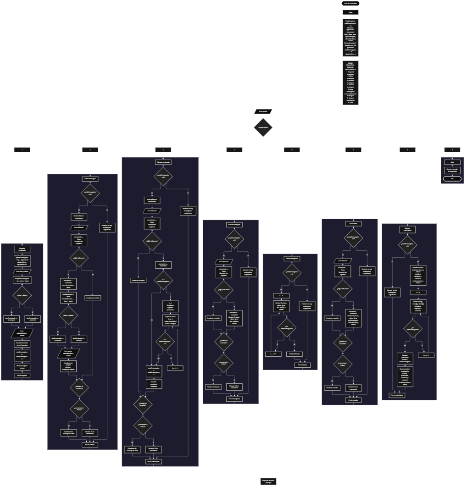

Este proyecto, llamado <b>área de rectángulo</b>, fue desarrollado en <b>pseint</b> como un ejercicio práctico para fortalecer la lógica de programación mediante la creación de un sistema de gestión de rectángulos desde la consola. El programa cuenta con un menú principal de ocho opciones que permite <b>registrar, editar, eliminar, buscar, listar, consultar los detalles y mostrar estadísticas</b> de los rectángulos registrados. Cada registro almacena información como el identificador, la base, la altura, el área calculada, el tipo de figura, la unidad de medida y el estado, utilizando siete arreglos con una capacidad definida de <b>100 posiciones</b>. Durante su desarrollo se aplicaron conceptos fundamentales de programación, como variables, arreglos, estructuras condicionales, ciclos repetitivos y estructuras de selección, además de procedimientos para buscar, modificar, eliminar y organizar registros. El proyecto también incorpora cálculos estadísticos para analizar las áreas, bases y alturas almacenadas. De esta manera, permite poner en práctica los conocimientos adquiridos en PSeInt y sirve como base para desarrollar sistemas de cálculo y gestión más avanzados utilizando otros lenguajes y tecnologías.

<h2 align="center">⚙️ Funcionamiento del menú principal</h2>

### ➕ Registrar rectángulo

La opción <b>1) registrar rectángulo</b> permite agregar un nuevo rectángulo al sistema. Para comenzar, el programa asigna un identificador utilizando la variable <b>siguienteID</b>, que aumenta en uno después de cada asignación. A continuación, solicita la <b>base y la altura</b> del rectángulo y calcula automáticamente su área mediante la fórmula <b>área = base × altura</b>. Después, compara ambos valores: si la base y la altura son iguales, asigna el tipo <b>"cuadrado"</b>; de lo contrario, asigna el tipo <b>"rectangulo"</b>. Finalmente, solicita la unidad de medida y el estado del registro, almacena la información en sus respectivos arreglos, incrementa la variable <b>totalRectangulos</b> y muestra un mensaje de confirmación. Sin embargo, aunque los arreglos tienen 100 posiciones, el código actual no comprueba si existe espacio disponible antes de registrar un nuevo rectángulo.

### ✏️ Editar rectángulo

La opción <b>2) editar rectángulo</b> permite modificar los datos de un rectángulo registrado. Primero, el programa comprueba si la variable <b>totalRectangulos</b> es igual a cero. Si no existen registros, muestra un mensaje indicando que no hay rectángulos registrados. En caso contrario, presenta una lista con el identificador, la base, la altura, el área, el tipo, la unidad de medida y el estado de cada registro. Después, solicita el identificador del rectángulo que se desea editar e inicializa la variable lógica <b>encontrado</b> con el valor <b>falso</b>. Mediante un ciclo <b>para</b>, recorre los registros y compara cada identificador con el valor introducido. Cuando encuentra una coincidencia, solicita la nueva base y altura, recalcula el área, actualiza el tipo de figura según la igualdad de ambas dimensiones y solicita la nueva unidad de medida y el estado. Finalmente, muestra un mensaje de confirmación. Si no encuentra el identificador solicitado, informa que no existe un rectángulo con ese ID.

### 🗑️ Eliminar rectángulo

La opción <b>3) eliminar rectángulo</b> permite eliminar un rectángulo registrado mediante su identificador. Antes de iniciar la operación, el programa comprueba si existen registros almacenados. Si no hay rectángulos, muestra un mensaje indicando que no existen registros. En caso contrario, presenta una lista con los datos de los rectángulos y solicita el identificador que se desea eliminar. A continuación, inicializa la variable <b>encontrado</b> con el valor <b>falso</b> y recorre los registros hasta encontrar una coincidencia. Cuando localiza el rectángulo, utiliza un ciclo <b>para</b>, controlado por la variable <b>j</b>, para desplazar los datos de las posiciones posteriores una posición hacia atrás en los siete arreglos: <b>id, base, altura, area, tipoRectangulo, unidadMedida y estado</b>. Después, disminuye la variable <b>totalRectangulos</b> en uno y muestra un mensaje de confirmación. El código no limpia explícitamente la última posición después de la eliminación y tampoco interrumpe expresamente el ciclo exterior tras encontrar el registro.

### 🔎 Buscar rectángulo

La opción <b>4) buscar rectángulo</b> permite localizar un registro mediante su identificador. Primero, el programa comprueba si existen rectángulos registrados. Si la variable <b>totalRectangulos</b> es igual a cero, muestra un mensaje indicando que no hay registros disponibles. En caso contrario, solicita el identificador del rectángulo que se desea buscar e inicializa la variable lógica <b>encontrado</b> con el valor <b>falso</b>. Después, utiliza un ciclo <b>para</b> para recorrer los registros y comparar el identificador solicitado con los valores almacenados en el arreglo <b>id</b>. Cuando encuentra una coincidencia, cambia la variable <b>encontrado</b> a <b>verdadero</b> y muestra la información del rectángulo, incluyendo su base, altura, área, tipo, unidad de medida y estado. Si finaliza el recorrido sin encontrar coincidencias, presenta un mensaje indicando que no se encontró un rectángulo con ese identificador.

### 📋 Listar rectángulos

La opción <b>5) listar rectángulos</b> permite visualizar todos los rectángulos registrados durante la ejecución del programa. Antes de mostrar la información, comprueba si la variable <b>totalRectangulos</b> es igual a cero. Si no existen registros, muestra un mensaje indicando que no hay rectángulos registrados. Si hay información disponible, utiliza un ciclo <b>para</b> para recorrer los arreglos desde la primera posición hasta el total actual de registros. Durante el recorrido, presenta el identificador, la base, la altura, el área calculada, el tipo de figura, la unidad de medida y el estado de cada rectángulo. Esta opción facilita consultar todos los registros almacenados sin necesidad de buscarlos individualmente.

### 📄 Ver detalles del rectángulo

La opción <b>6) ver detalles del rectángulo</b> permite consultar de forma individual la información completa de un registro. Primero, el programa comprueba si existen rectángulos registrados. Si no hay datos almacenados, muestra el mensaje correspondiente. En caso contrario, solicita el identificador del rectángulo que se desea consultar e inicializa la variable <b>encontrado</b> con el valor <b>falso</b>. A continuación, recorre los registros mediante un ciclo <b>para</b> y compara el identificador introducido con los valores del arreglo <b>id</b>. Si encuentra una coincidencia, muestra los datos en líneas separadas: <b>identificador, base, altura, área, tipo de rectángulo, unidad de medida y estado</b>. Si el identificador no corresponde a ningún registro, presenta un mensaje indicando que no se encontró el rectángulo solicitado.

### 📊 Mostrar estadísticas

La opción <b>7) mostrar estadísticas</b> permite analizar los datos numéricos de los rectángulos registrados. Primero, comprueba si existen registros almacenados. Si no hay rectángulos, muestra un mensaje indicando que no existen datos para realizar los cálculos. Si hay registros disponibles, inicializa las variables destinadas a acumular las áreas, bases y alturas, y utiliza los primeros valores almacenados para establecer los valores iniciales de los máximos y mínimos. Después, recorre los registros mediante un ciclo <b>para</b>, sumando las áreas, bases y alturas, y comparando cada valor para determinar el mayor y el menor de cada conjunto. Al finalizar, calcula los promedios dividiendo las sumas correspondientes entre <b>totalRectangulos</b>. Finalmente, muestra el total de rectángulos, la suma, el promedio, el valor mayor y el valor menor de las áreas, bases y alturas. Es importante señalar que las variables utilizadas para estos cálculos estadísticos no aparecen en la sección <b>definir</b> del código proporcionado, por lo que conviene declararlas explícitamente para mantener una estructura consistente y evitar problemas de ejecución según la configuración de PSeInt.

### 🚪 Salir del menú principal

La opción <b>8) salir</b> está destinada a finalizar la ejecución del programa y muestra un mensaje de despedida al usuario. El menú principal se encuentra dentro de una estructura repetitiva <b>repetir ... hasta que</b>, que permite ejecutar las distintas operaciones de gestión antes de finalizar. En este caso, la condición de salida utiliza la expresión <b>hasta que opcion = 8</b>, por lo que coincide con la opción presentada en el menú. Cuando el usuario selecciona el número ocho, el programa muestra el mensaje de despedida y finaliza el ciclo repetitivo. Si se introduce un número que no corresponde a ninguna de las opciones disponibles, la estructura <b>segun</b> ejecuta el bloque <b>de otro modo</b> y muestra un mensaje indicando que la opción no es válida.

<h2 align="center">🧠 Temas aplicados en el proyecto</h2>

### 📦 Variables

En este proyecto se utilizan variables para controlar el menú principal, almacenar la cantidad de rectángulos registrados, generar identificadores consecutivos, recorrer los arreglos y localizar los registros que se desean editar, eliminar, buscar o consultar. También se utilizan variables para almacenar las dimensiones de cada figura, calcular su área, determinar su clasificación y registrar la información relacionada con la unidad de medida y el estado. En la opción de estadísticas se emplean variables adicionales para acumular valores, calcular promedios y determinar los máximos y mínimos.

🔢 **Opcion:** Almacena el número seleccionado por el usuario en el menú principal.

📊 **TotalRectangulos:** Almacena la cantidad actual de rectángulos registrados.

🆔 **SiguienteID:** Genera identificadores consecutivos para los nuevos registros.

🔄 **I:** Funciona como contador para recorrer los arreglos y acceder a los registros.

🔁 **J:** Controla el desplazamiento de los datos durante la eliminación de un rectángulo.

🔎 **IDBuscar:** Almacena el identificador introducido por el usuario para localizar un registro.

✅ **Encontrado:** Variable lógica que indica si se ha encontrado el identificador solicitado.

📐 **Base:** Almacena la base de un rectángulo.

📏 **Altura:** Almacena la altura de un rectángulo.

🧮 **Area:** Almacena el resultado del cálculo de la superficie.

🗂️ **TipoRectangulo:** Almacena la clasificación de la figura como cuadrado o rectángulo.

📐 **UnidadMedida:** Almacena la unidad de medida indicada para el registro.

📌 **Estado:** Almacena el estado asociado al rectángulo.

### 🗃️ Arreglos

En este proyecto se utilizan siete arreglos de <b>100 posiciones</b> para almacenar la información de los rectángulos. Cada arreglo contiene un tipo de dato específico y utiliza el mismo índice para relacionar los datos de una misma figura. Por ejemplo, la información del rectángulo situado en la posición <b>1</b> se distribuye entre <b>id[1], base[1], altura[1], area[1], tipoRectangulo[1], unidadMedida[1] y estado[1]</b>. Esta organización permite recorrer, consultar, modificar y eliminar registros utilizando sus posiciones correspondientes. Aunque cada arreglo tiene 100 posiciones, el programa no comprueba la capacidad disponible antes de agregar nuevos registros.

🆔 **Id[100]:** Almacena los identificadores de los rectángulos registrados.

📐 **Base[100]:** Almacena las bases de los rectángulos.

📏 **Altura[100]:** Almacena las alturas de los rectángulos.

🧮 **Area[100]:** Almacena las áreas calculadas a partir de la base y la altura.

🗂️ **TipoRectangulo[100]:** Almacena la clasificación de cada figura.

📏 **UnidadMedida[100]:** Almacena las unidades de medida indicadas.

📌 **Estado[100]:** Almacena el estado de cada registro.

### 🔀 Estructuras condicionales

En este proyecto se utilizan las estructuras <b>si</b> y <b>sino</b> para comprobar si existen rectángulos registrados antes de realizar las operaciones, determinar si la base y la altura son iguales para clasificar una figura, verificar si un identificador coincide con alguno de los registros y decidir si se ha encontrado la información solicitada. También se emplean condiciones para comparar las áreas, bases y alturas durante el cálculo de las estadísticas. Estas estructuras permiten que el programa ejecute instrucciones diferentes según los datos almacenados y los resultados obtenidos en cada operación.

### 🔄 Estructuras repetitivas

En este proyecto se utilizan los ciclos <b>para</b> y <b>repetir ... hasta que</b>. Los ciclos <b>para</b> permiten recorrer los arreglos para buscar identificadores, mostrar registros, editar datos, calcular estadísticas y desplazar la información durante la eliminación de un rectángulo. Por otro lado, el ciclo <b>repetir ... hasta que</b> mantiene activo el menú principal y permite que el usuario realice distintas operaciones hasta seleccionar la opción de salida. Estas estructuras facilitan la ejecución repetida de tareas y el procesamiento de varios registros sin tener que escribir las mismas instrucciones para cada posición.

### 🎯 Estructura según

El programa utiliza la estructura <b>segun</b> para evaluar el valor almacenado en la variable <b>opcion</b> y ejecutar el bloque de instrucciones correspondiente. Cada caso representa una operación específica del sistema: <b>registrar, editar, eliminar, buscar, listar, ver detalles, mostrar estadísticas o salir</b>. También se utiliza el bloque <b>de otro modo</b> para mostrar un mensaje de opción no válida cuando el número introducido no coincide con ninguna de las opciones definidas en el menú. Esta estructura organiza las operaciones y facilita la navegación entre las diferentes funcionalidades del programa.

### 🔢 Dimensionamiento de arreglos

El programa utiliza la instrucción <b>dimension</b> para establecer el tamaño de los siete arreglos que almacenan los datos de los rectángulos. Cada uno dispone de <b>100 posiciones</b>, y la variable <b>totalRectangulos</b> controla cuántos registros se consideran activos durante la ejecución. Las operaciones recorren las posiciones desde la primera hasta el total actual de registros. Sin embargo, el código no incorpora una comprobación que impida registrar más de 100 rectángulos, por lo que la capacidad definida no está protegida mediante una validación específica.

### 🔄 Reorganización de registros

Cuando se elimina un rectángulo, el programa utiliza un ciclo <b>para</b> controlado por la variable <b>j</b> para desplazar los datos de las posiciones posteriores una posición hacia atrás. El desplazamiento se realiza en los siete arreglos: <b>id, base, altura, area, tipoRectangulo, unidadMedida y estado</b>. Después, la variable <b>totalRectangulos</b> disminuye en uno, de manera que el registro eliminado deja de formar parte de la cantidad de elementos activos. En el código actual no se limpia explícitamente la última posición después del desplazamiento, aunque esta queda fuera del rango de registros activos controlado por el contador.

<h2 align="center">¿Cómo se implementaron las operaciones crud en el proyecto?</h2>

Las operaciones <b>crud</b> se implementaron mediante las opciones del menú principal, permitiendo administrar los rectángulos registrados. La operación <b>crear</b> corresponde a <b>registrar rectángulo</b>, donde se introducen la base, la altura, la unidad de medida y el estado, y se calcula automáticamente el área. La operación <b>leer</b> se realiza mediante las opciones <b>buscar rectángulo, listar rectángulos y ver detalles del rectángulo</b>, que permiten consultar la información almacenada. La operación <b>actualizar</b> corresponde a <b>editar rectángulo</b>, donde se modifican las dimensiones y los demás datos del registro seleccionado. Finalmente, la operación <b>eliminar</b> se realiza mediante la opción <b>eliminar rectángulo</b>, que retira el registro y desplaza los datos posteriores. Estas operaciones utilizan variables, arreglos, estructuras condicionales y ciclos para gestionar la información temporalmente durante la ejecución del programa.

<h2 align="center">Diagrama de flujo del proyecto</h2>

<h2 align="center">🛡️ Validaciones del programa</h2>

### 📭 No existen rectángulos registrados

Esta comprobación se utiliza en las operaciones que necesitan registros existentes, como editar, eliminar, buscar, listar, consultar detalles y mostrar estadísticas. El programa verifica si la variable <b>totalRectangulos</b> es igual a <b>0</b>. Si no existen rectángulos registrados, muestra un mensaje indicando que no hay información disponible y evita realizar los procesos que dependen de los registros almacenados. De esta manera, el programa contempla el caso en el que el usuario intenta utilizar las opciones sin haber registrado previamente un rectángulo.

### ❌ Rectángulo no encontrado

Esta comprobación se utiliza en las operaciones de edición, eliminación, búsqueda y consulta de detalles. El programa inicializa la variable lógica <b>encontrado</b> con el valor <b>falso</b> y recorre los registros para comparar el identificador solicitado con los valores almacenados en el arreglo <b>id</b>. Cuando encuentra una coincidencia, cambia la variable a <b>verdadero</b> y ejecuta las instrucciones correspondientes a la operación seleccionada. Si termina el recorrido sin encontrar el identificador, muestra un mensaje indicando que no se encontró un rectángulo con ese ID.

### ⚠️ Capacidad de los arreglos

Los siete arreglos del programa están dimensionados para almacenar <b>100 registros</b>. Sin embargo, en la opción de registro no se comprueba si la variable <b>totalRectangulos</b> ha alcanzado esa cantidad antes de almacenar nuevos datos. Por este motivo, el programa no impide que se intente registrar más información de la que permiten las posiciones definidas. Para reforzar esta parte del sistema, sería necesario incorporar una condición que compruebe la disponibilidad de espacio antes de asignar los datos del nuevo rectángulo.

### 📐 Cálculo y clasificación de la figura

El programa calcula el área multiplicando la base por la altura y determina el tipo de figura comparando ambas dimensiones. Si <b>base = altura</b>, asigna la clasificación <b>"cuadrado"</b>; si los valores son diferentes, asigna <b>"rectangulo"</b>. Esta comprobación se realiza tanto al registrar un rectángulo como al editar sus dimensiones. No obstante, el código proporcionado no comprueba que la base y la altura sean valores positivos, por lo que no valida expresamente que las dimensiones introducidas sean apropiadas para una figura geométrica convencional.

### 📊 Cálculo de estadísticas

La opción de estadísticas comprueba que existan rectángulos registrados antes de calcular las sumas, los promedios y los valores mayores y menores de las áreas, bases y alturas. Los promedios se calculan dividiendo las sumas entre <b>totalRectangulos</b>, por lo que el programa evita efectuar estas divisiones cuando el total es cero. Sin embargo, las variables utilizadas para almacenar los resultados estadísticos no aparecen declaradas en la sección <b>definir</b> del código proporcionado. Es recomendable declararlas explícitamente para mantener la organización de las variables y facilitar la compatibilidad con la configuración de PSeInt utilizada.

### ⚠️ Opción inválida

La estructura <b>segun</b> incluye el bloque <b>de otro modo</b>, que se ejecuta cuando el usuario introduce un número que no corresponde a ninguna de las ocho opciones disponibles. En ese caso, el programa muestra un mensaje indicando que la opción no es válida. Esta comprobación permite informar al usuario cuando selecciona una operación que no está definida en el menú principal.

<h2 align="center">🎯 Objetivo del proyecto</h2>

El objetivo principal de este proyecto es fortalecer la <b>lógica de programación</b> mediante el desarrollo de un sistema de cálculo y gestión de rectángulos en <b>pseint</b>. A través de su construcción se busca aplicar los conocimientos adquiridos sobre variables, arreglos, estructuras condicionales, ciclos repetitivos y estructuras de selección, integrándolos para resolver un problema de manera organizada. Además, el proyecto permite comprender cómo registrar, consultar, modificar y eliminar información, calcular áreas mediante la multiplicación de las dimensiones y obtener estadísticas a partir de los datos almacenados. De esta manera, constituye una base para desarrollar programas matemáticos y sistemas de gestión más completos utilizando otros lenguajes y tecnologías.

